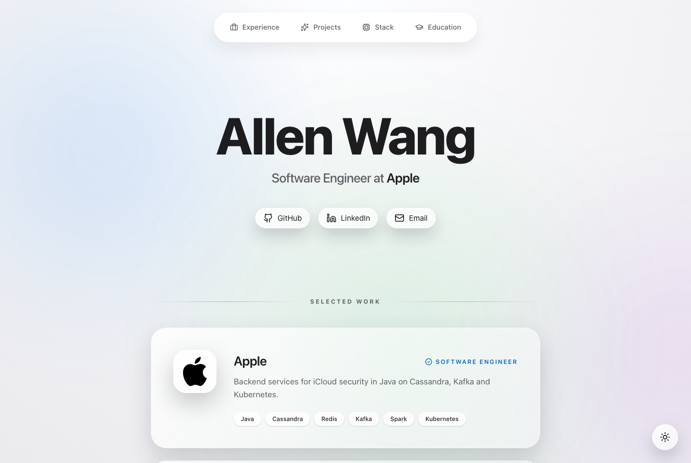
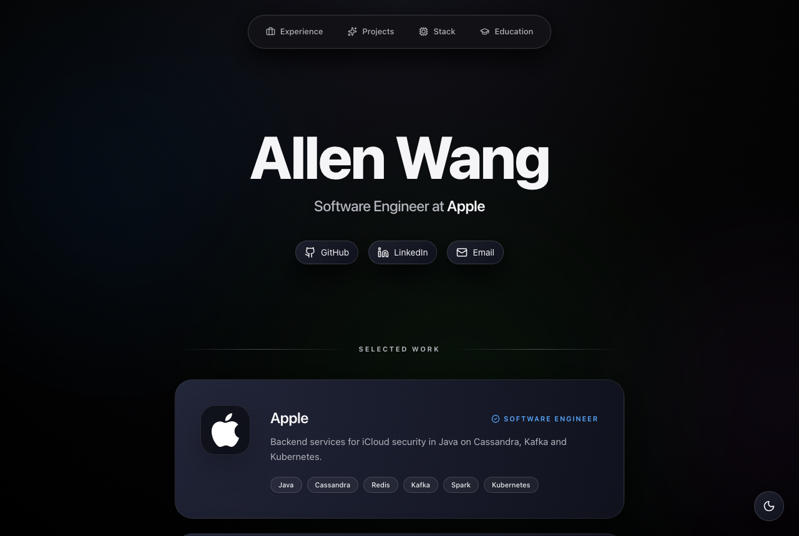

# allenwang0.github.io

My personal site and project portfolio, live at https://allenwang0.github.io.

| Light                                          | Dark                                         |
| ---------------------------------------------- | -------------------------------------------- |
|  |  |

## Stack

- Astro static build with Tailwind CSS. No client framework; the only scripts are a small inline theme toggle and Google Analytics.
- Lucide icons are inlined as SVG at build time. Charts are inline SVG drawn at build time.
- GitHub Actions builds and deploys the site to GitHub Pages.

## Run locally

Node 22.23.4 or newer (`.nvmrc` pins 24).

```sh
npm ci
npm run dev        # http://localhost:4321
npm run build      # fetch-projects, check-claims, then astro build into dist/
npm test           # vitest unit tests, then Playwright against astro preview
```

Playwright needs Chromium once: `npx playwright install chromium`.

Other checks CI runs: `npm run lint`, `npm run check` (astro check), `npm run validate-html`, lychee with `lychee.toml`, and `npx lhci autorun` with the budgets in `lighthouserc.json`.

## Editing content

All content lives in `src/data/site.json`: profile, experience, project groups, projects, the "More projects" list, education and stack.

### Projects and the source rule

Each project has a `state`:

- `hidden`: not rendered anywhere.
- `today` or `after`: rendered as a card and a case-study page at `/projects/<slug>/`. `today` is the text the repo supports now; switch to `after` only when the repo's default branch contains the planned feature.

A visible project pins a commit in `sha`. Every blurb sentence, tag, problem, approach and limitation carries a `source`: a file path (or list of paths) in that repo. `scripts/check-claims.mjs` fails the build if a claim has no source or the path does not exist at the pinned SHA. It checks through the GitHub contents API and caches answers in `src/data/cache/claims.json`.

To add a project: add an entry with `state: "hidden"`, fill in `sha`, `blurb`, `tags` and `case_study` with sources, set `state` to `today`, and run `npm run build`.

### Repo data and card.json

`scripts/fetch-projects.mjs` reads each visible repo's description, language and last push date from the GitHub API, the case-study code excerpt at the pinned SHA, and `site/card.json` at the pinned SHA. It writes `src/data/cache/projects.json`. If a request fails, it keeps the cached entry for that repo and logs a warning. Set `GITHUB_TOKEN` to avoid the unauthenticated rate limit.

`site/card.json` is the contract between a project repo and this site. Its schema is `scripts/card.schema.json` (schema_version 1): the commit and command that produced the file, a note on whether the data is real, simulated or synthetic, one metric, a takeaway of at most 140 characters, and an optional line or interval chart. The build fails with the repo name and JSON path when a card does not validate, or when its `sha` is not an ancestor of the pinned SHA. A project without a card shows "Results pending".

`scripts/fixtures/` holds synthetic cards used only by the unit tests. Every fixture says so in its `data_note`; none is ever rendered on the site.

## Deploy

`.github/workflows/deploy.yml` runs on every push to `main`: it builds, commits the refreshed project cache if it changed, and deploys `dist/` with `actions/deploy-pages`. In the repo settings, Pages source must be set to "GitHub Actions". `.github/workflows/ci.yml` runs the full check suite on pull requests.

## License

Code is MIT (see `LICENSE`). Site text is copyright Allen Wang, all rights reserved. The Apple, Millennium, Stanford and Oxford marks belong to their owners; sources are in `public/logos/SOURCES.md`.
