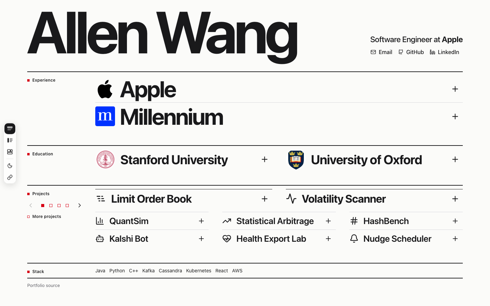
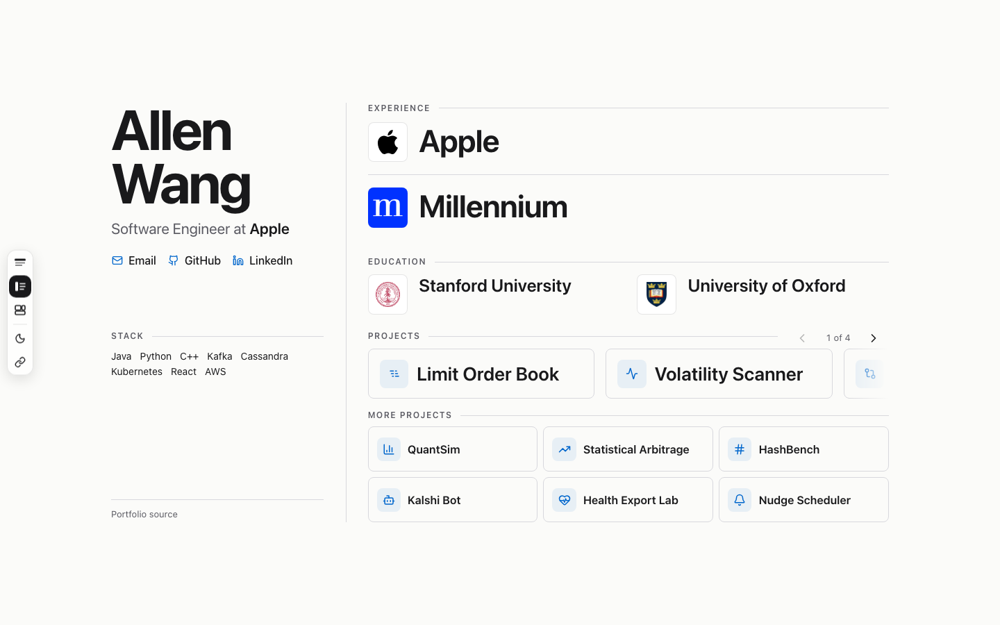
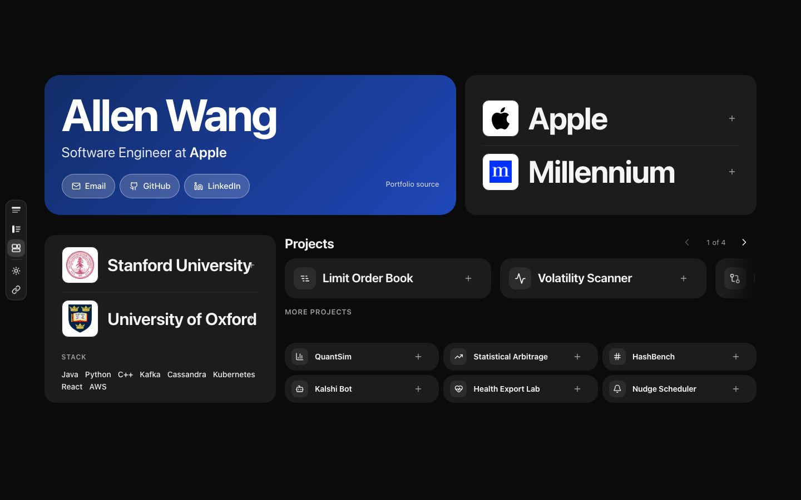

# allenwang0.github.io

My personal site and project portfolio, live at https://allenwang0.github.io.

The home page is one HTML file with three layouts. Visitors switch between them with the rail on the left (the pill at the bottom on phones). `?layout=poster|resume|bento` links to a layout, and a project id such as `#lob` opens that project.

| Poster (default)                       | Résumé                                 | Bento (dark)                         |
| -------------------------------------- | -------------------------------------- | ------------------------------------ |
|  |  |  |

## Stack

- Astro static build. The home page is `src/pages/index.html`: hand-written HTML, CSS and a small inline script for the layouts, theme, details panels and carousel. No client framework. Google Analytics is the only third-party script.
- Lucide icons are inlined as SVG at build time.
- GitHub Actions builds and deploys the site to GitHub Pages.

## Run locally

Node 22.23.4 or newer (`.nvmrc` pins 24).

```sh
npm ci
npm run dev        # http://localhost:4321
npm run build      # check-claims, then astro build into dist/
npm test           # Playwright against astro preview
```

Playwright needs Chromium once: `npx playwright install chromium`.

Other checks CI runs: `npm run lint`, `npm run check` (astro check), `npm run validate-html`, lychee with `lychee.toml`, and `npx lhci autorun` with the budgets in `lighthouserc.json`.

## Editing content

Page copy lives in `src/pages/index.html`. `src/data/site.json` holds the profile, project list and report URLs used by the share image, the sitemap and the tests, plus the sourced project claims checked below. When you rename or add a project, change both.

### Projects and the source rule

Each project has a `state`:

- `hidden`: not rendered anywhere.
- `today` or `after`: rendered as a card linking to the repo. Cards appear in the order they are listed.

A visible project pins a commit in `sha`. Every blurb and tag carries a `source`: a file path (or list of paths) in that repo. `scripts/check-claims.mjs` fails the build if a claim has no source or the path does not exist at the pinned SHA. It checks through the GitHub contents API and caches answers in `src/data/cache/claims.json`.

To add a project: add an entry with `state: "hidden"`, fill in `sha`, `blurb` and `tags` with sources, set `state` to `today`, and run `npm run build`.

## Deploy

`.github/workflows/deploy.yml` runs on every push to `main`: it builds, commits the refreshed claims cache if it changed, and deploys `dist/` with `actions/deploy-pages`. In the repo settings, Pages source must be set to "GitHub Actions". `.github/workflows/ci.yml` runs the full check suite on pull requests.

## License

Code is MIT (see `LICENSE`). Site text is copyright Allen Wang, all rights reserved. The Apple, Millennium, Stanford and Oxford marks belong to their owners; sources are in `public/logos/SOURCES.md`.
